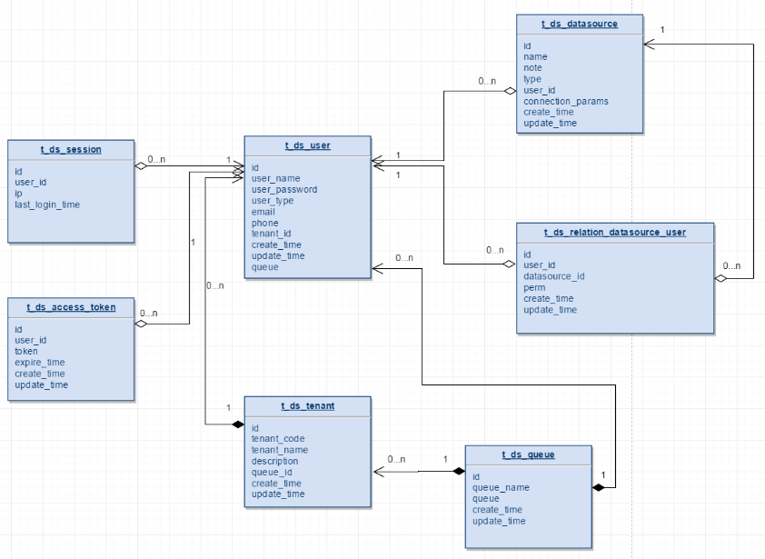
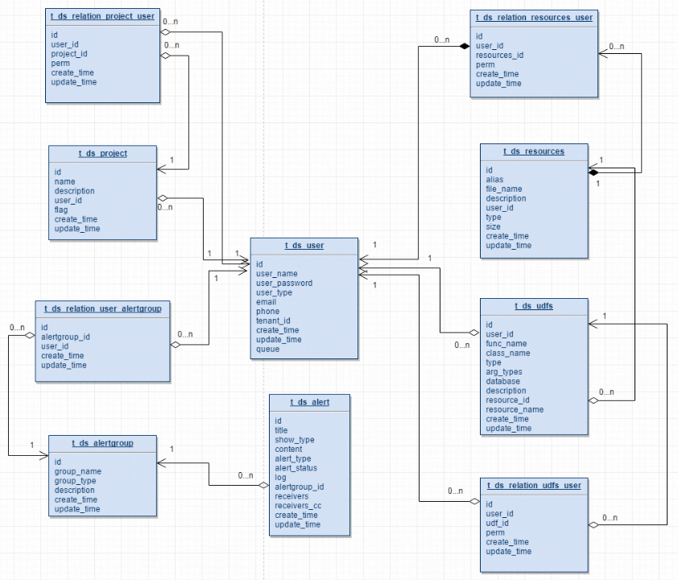
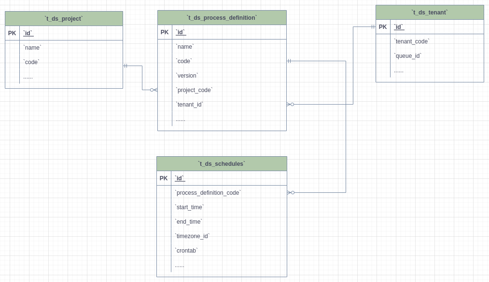
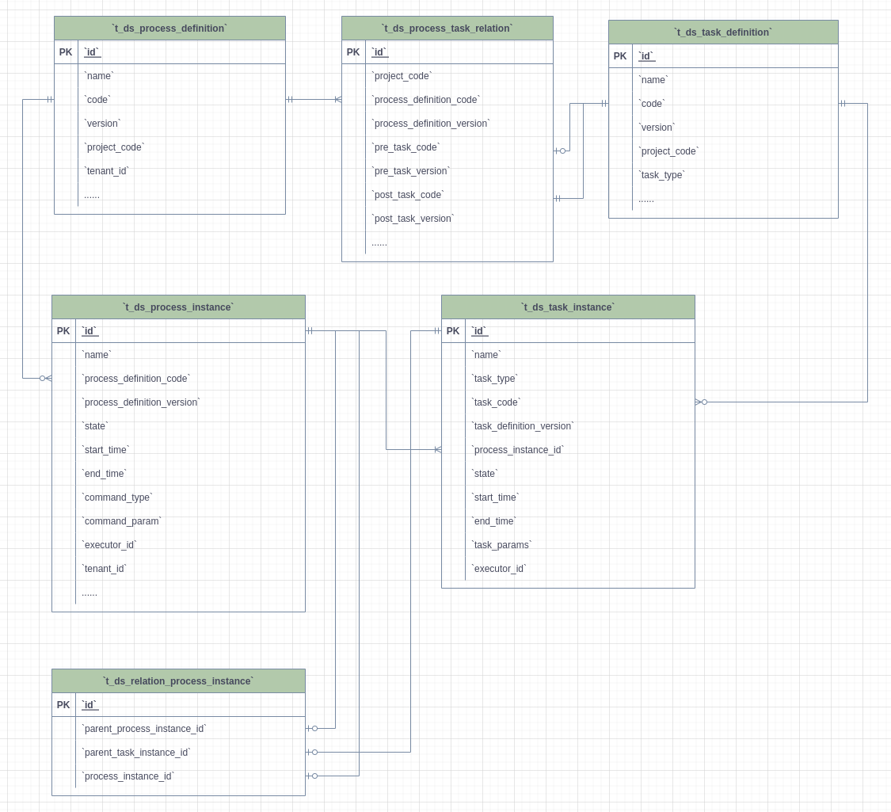

# MetaData

## Table Schema

See the SQL files in `dolphinscheduler-dao/src/main/resources/sql`, which are the source of truth. For how workflows and tasks are stored, see [Task Structure](task-structure.md).

> The E-R diagrams below were drawn before the `process` tables were renamed to `workflow`, so some table names in the
> pictures are outdated. The descriptions use the current table names.

---

## E-R Diagram

### User Queue DataSource

- One tenant can own multiple users. `t_ds_user.tenant_id` is `-1` when the user has no tenant.
- The queue field in the `t_ds_user` table stores the `queue_name` information in the `t_ds_queue` table, `t_ds_tenant` stores queue information using `queue_id` column. When the queue of a user is empty, the user page shows the queue of the tenant instead. The YARN queue used by a task is set by the parameters of the task itself, e.g. `yarnQueue` of SPARK, MR and FLINK.
- The `user_id` field in the `t_ds_datasource` table shows the user who create the data source. The user_id in `t_ds_relation_datasource_user` shows the user who has permission to the data source.

### Project Resource Alert

- User can have multiple projects, user project authorization completes the relationship binding using `project_id` and `user_id` in `t_ds_relation_project_user` table.
- The `user_id` in the `t_ds_project` table represents the user who create the project, and the `user_id` in the `t_ds_relation_project_user` table represents users who have permission to the project.
- Resources are kept by the storage plugin. `t_ds_resources` in the diagram is only read by the resource migration tool.
- Alert groups are stored in `t_ds_alertgroup` and referenced by `warning_group_id` of `t_ds_schedules` and `t_ds_workflow_instance`.

### Project - Tenant - Workflow Definition - Schedule

- A project can have multiple workflow definitions, and each workflow definition belongs to only one project.
- A tenant can be used by multiple workflows. The tenant is not part of the workflow definition, it is chosen when the workflow is started or scheduled, and stored in `t_ds_schedules.tenant_code`, `t_ds_command.tenant_code` and `t_ds_workflow_instance.tenant_code`, which default to `default`.
- A workflow definition can have zero or one schedule.

### Workflow Definition Execution

- A workflow definition corresponds to multiple task definitions, which are associated through `t_ds_workflow_task_relation` and the associated key is `code + version`. When the task has no upstream task, the corresponding `pre_task_code` and `pre_task_version` are 0.
- A workflow definition can have multiple workflow instances `t_ds_workflow_instance`, one workflow instance corresponds to zero or more task instances `t_ds_task_instance`.
- The data stored in the `t_ds_relation_workflow_instance` table is used to handle the case that the workflow definition contains sub-workflows. `parent_workflow_instance_id` represents the id of the parent workflow instance containing the sub-workflow, `workflow_instance_id` represents the id of the sub-workflow instance, `parent_task_instance_id` represents the task instance id of the sub-workflow node. The workflow instance table and the task instance table correspond to the `t_ds_workflow_instance` table and the `t_ds_task_instance` table, respectively.

