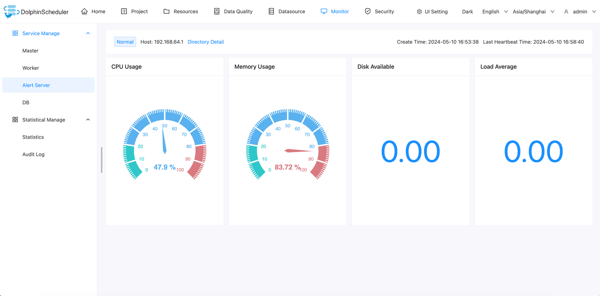
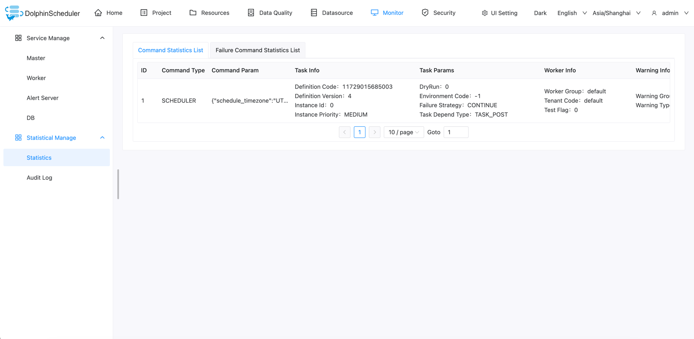
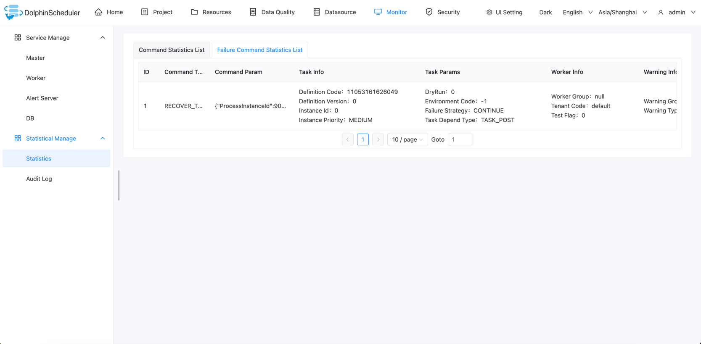
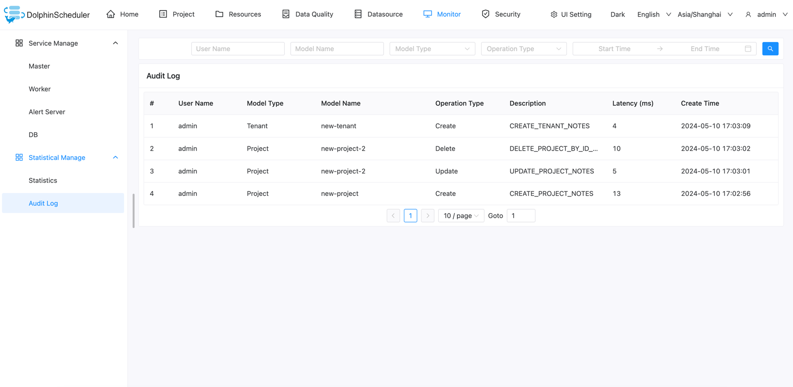

# Monitor

## Service Management

- Service management is mainly to monitor and display the health status and basic information of each service in the system.

### Cluster Overview

The cluster overview replaces the separate Master and Worker pages. It discovers registered API, Master, Worker, and Alert Server instances and queries their current metadata through the monitoring API. API, Master, and Worker appear from top to bottom. Worker groups can be expanded to inspect individual nodes. Connections describe logical architecture, not observed network traffic.

The node list includes CPU and memory utilization. Failed metadata queries leave the registered instance visible with unavailable metrics; they do not mark it offline. Alert Server Active/Standby roles are displayed separately from node health. Refresh queries current membership and metadata again. A partial request failure is shown explicitly, and previously loaded nodes for that role are retained with unavailable metrics.

Administrators can open running workflows and running tasks on a Master, or running tasks on a Worker, from node details or list actions. Workflow-instance links open the corresponding project instance page. Failed runtime queries show an error and a retry action rather than an empty list.

API instances register stable identity under `/nodes/api` and serve metadata on `api.rpc-port` (default `12346`). Allow API instances to reach each other's metadata RPC ports over the internal network. The listener uses the existing `rpc.authentication.*` settings. API HTTP ports are reported separately and remain unchanged. API instances must be upgraded to appear in discovery; this page does not infer unregistered instances.

The former Master, Worker, and DB URLs redirect to the cluster overview. The standalone DB page entry has been removed; the Alert Server page remains available.

### Alert Server

- Mainly related to alert server information.

## Statistics Management

### Statistics

Shows the command list in the system. Data is from the `t_ds_command` table.

Shows the failure command list in the system. Data is from the `t_ds_error_command` table.

### Audit Log

The audit log provides information about who accesses the system and the operations made to the system and record related
time, which strengthen the security of the system and maintenance.

