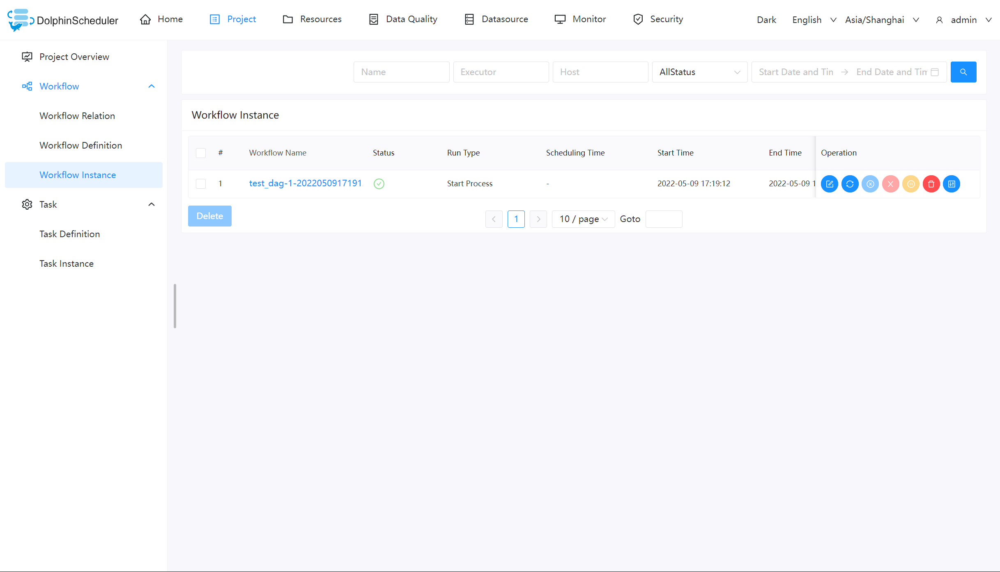
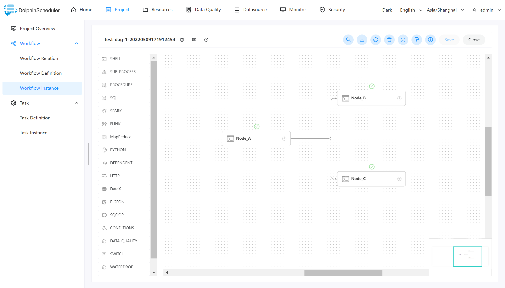
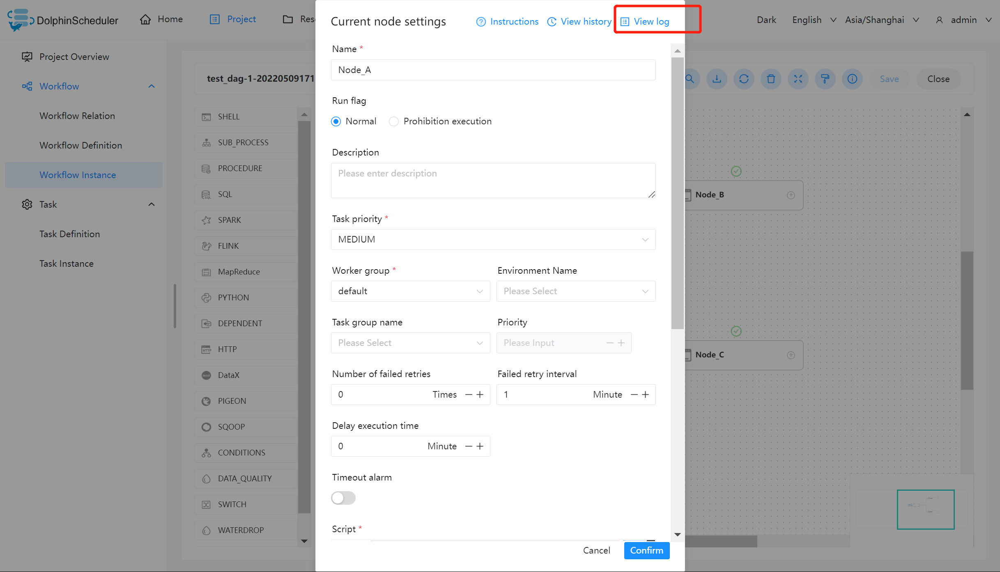
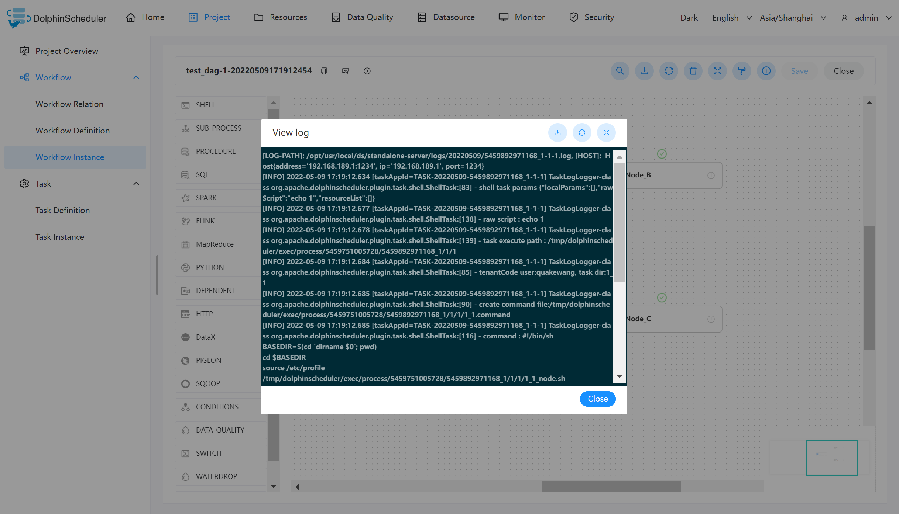
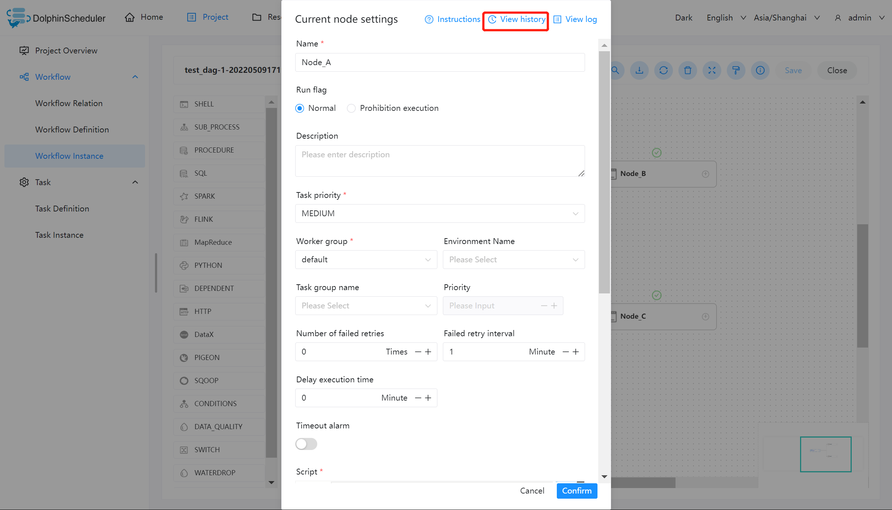
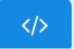
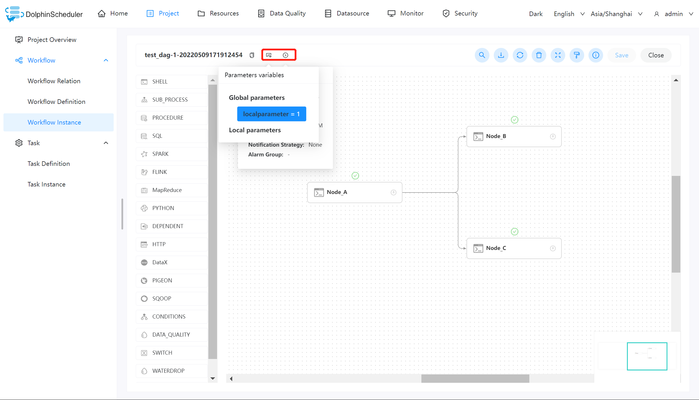
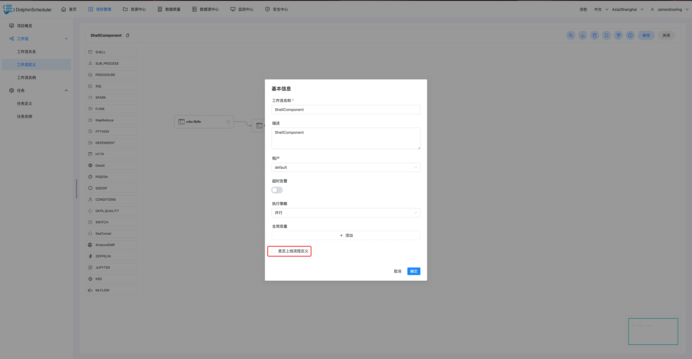

# Workflow Instance

## View Workflow Instance

Click `Project Management -> Workflow -> Workflow Instance`, enter the Workflow Instance page, as shown in the following
figure:

Click the workflow name to enter the DAG view page, and check the task execution status, as shown in the following
figure:

## View Task Log

Enter the workflow instance page, click the workflow name, enter the DAG view page, double-click the task node, as shown
in the following figure:

Click "View Log", a log window pops up, as shown in the figure below, you can also view the task log on the task
instance page, refer to [Task View Log](./task-instance.md)

## View Task History

Click `Project Management -> Workflow -> Workflow Instance` to enter the workflow instance page, click the workflow name
to enter the workflow DAG page;

Double-click the task node, click `View History` to jump to the task instance page, and display the list of task
instances run by the task definition.

## View Running Parameters

Click `Project Management -> Workflow -> Workflow Instance` to enter the workflow instance page, click the workflow name
to enter the workflow DAG page;

Click the icon in the upper left corner  to view the
startup parameters of the workflow instance; click the icon  to
view the global parameters and local parameters of the workflow instance, as shown in the following figure:

## Workflow Instance Operation Function

Click `Project Management -> Workflow -> Workflow Instance`, enter the workflow instance page, as shown in the following
figure:

| WorkflowInstanceState \ Operation | Edit | Rerun | Stop | Pause | Resume Suspend | Delete | Gantt Chart |
|-----------------------------------|------|-------|------|-------|----------------|--------|-------------|
| SUBMITTED_SUCCESS                 |      |       | √    | √     |                |        | √           |
| SERIAL_WAIT                       |      |       | √    |       |                |        | √           |
| FAILOVER                          |      |       |      |       |                |        | √           |
| Executing                         |      |       | √    | √     |                |        | √           |
| READY PAUSE                       |      |       |      |       |                |        | √           |
| PAUSE                             | √    | √     |      |       | √              | √      | √           |
| READY STOP                        |      |       |      |       |                |        | √           |
| STOP                              | √    | √     |      |       | √              | √      | √           |
| FAILURE                           | √    | √     |      |       |                | √      | √           |
| SUCCESS                           | √    | √     |      |       |                | √      | √           |

- **Edit:** Only processes with success/failed/stop status can be edited. Click the "Edit" button or the workflow
  instance name to enter the DAG edit page. After the edit, click the "Save" button to confirm, as shown in the figure
  below. In the pop-up box, check "Whether to update the workflow definition", after saving, the information modified by
  the instance will be updated to the workflow definition; if not checked, the workflow definition would not be updated.

     

       
     

- **Rerun：** Re-execute the terminated process

- **Recovery Failed:** For failed processes, you can perform failure recovery operations, starting from the failed node

- **Stop:** **Stop** the running process, the background code will first `kill` the worker process, and then
  execute `kill -9` operation

- **Pause:** **Pause** the running process, the system status will change to **waiting for execution**, it will wait for
  the task to finish, and pause the next sequence task.

- **Resume pause:** Resume the paused process, start running directly from the **paused node**

- **Delete:** Delete the workflow instance and the task instance under the workflow instance

- **Gantt Chart:** Open the chart from a workflow instance to see its task execution timeline. The summary above the
  chart shows the total and submitted task counts, plus counts for not submitted, queued/waiting, running, succeeded,
  failed, and paused/stopped tasks. Rows follow the workflow's task order and show each task's state, start and end
  times, duration, and share of the displayed time range. Parallel tasks can make the shares add up to more than 100%.
  Select a task name to copy it, or use the icons beside the task to view its log or read-only configuration when
  available. The log dialog can refresh or download the log; its preview is limited to 20,000 lines.

  While the workflow is running, **Refresh every 5s while running** is enabled by default. You can turn it off or use
  **Refresh** manually. Automatic requests pause when the browser tab is hidden and stop after the workflow finishes.
  If a refresh fails, the last successful snapshot remains visible.

  The horizontal scale is labeled **Workflow elapsed** when precise workflow timing is available. If workflow dates
  have only second-level precision and a complete millisecond task range is unavailable, it is labeled **Workflow
  elapsed (approx.)**; its boundaries and task shares are approximate. When workflow timing cannot be used but task
  times are available, **Task time span** covers the first task start through the last task end, so it excludes time
  outside those tasks. These labels describe different denominators for the displayed task shares.

