# Security (Authorization System)

System administrators use the Security Center to manage queues, tenants, users, alert groups, worker groups, tokens and other global settings. Project member permissions and project resource-use grants are configured in Project Management; their boundaries are described under Granted Permissions below.

Administrator login, default username/password: admin/dolphinscheduler123

## Create Queue

- The queue is used when executing programs such as spark and mapreduce, and the "queue" parameter needs to be used.
- The administrator enters the `Security Center->Queue Management` page and clicks the "Create Queue" button to create a new queue.

> Note: Currently, only admin users can modify queues.

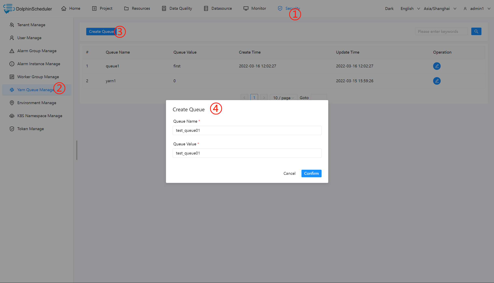

## Add Tenant

- The tenant corresponds to the Linux user, which is used by the worker to submit the job. If linux does not have this user, it will cause the task to fail. You can automatically create a linux user when the user does not exist by modifying the parameters in the `worker.properties` configuration file. The parameter will require that the worker can run the command `worker.tenant.auto.create = true; worker.tenant.auto.create = truesudo`
- Tenant Code: **The tenant code is the user on Linux, unique and cannot be repeated**
- The administrator enters the `Security Center->Tenant Management` page, and clicks the `Create Tenant` button to create a tenant.

> Note:
> 1. Currently, only admin users can modify tenant.
> 2. If you create a tenant manually in the Linux, you need to add the manually created tenant to the dolphinscheduler bootstrap user's group, so that the tenant will have enough working directory permissions.

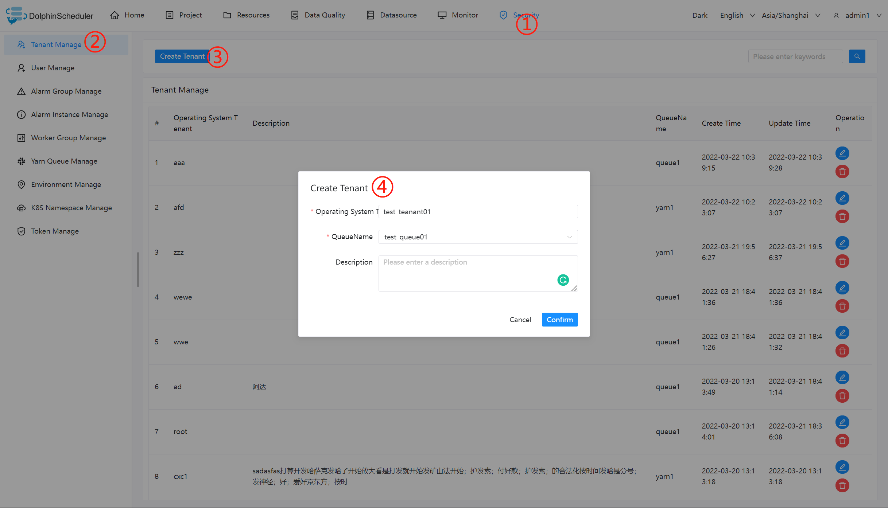

## Create Normal User

Users are divided into **administrator users** and **ordinary users**

- System administrators manage global settings and pass project operation checks; using project resources still requires the corresponding project grants.
- Ordinary users can create projects and view, develop, publish or execute workflows according to their explicitly assigned project permissions.
- **Note**: If the user switches tenants, all resources under the tenant to which the user belongs will be copied to the new tenant that is switched.

Go to the `Security Center -> User Management` page and click the `Create User` button to create a user, administrator only.

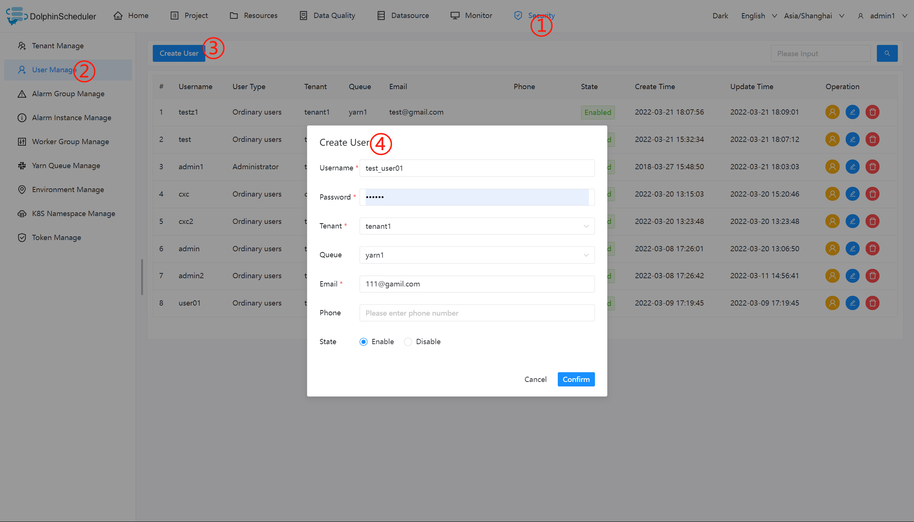

### Edit user information

The administrator enters the `Security Center->User Management` page and clicks the `Edit` button to edit user information.

After logging in as an ordinary user, click the user information in the drop-down box of the user name to enter the user information page, and click the `Edit` button to edit the user information.

### Modify user password

The administrator enters the `Security Center -> User Management` page and clicks the `Edit` button. When editing user information, enter the new password to modify the user password.

After logging in as an ordinary user, click the user information in the user name drop-down box to enter the password modification page, enter the password and confirm the password and click the `Edit` button, then the password modification is successful.

## Create Alarm Group

The alarm group is a parameter set at startup. After the process ends, the status of the process and other information will be sent to the alarm group by email.

The administrator enters the `Security Center -> Alarm Group Management` page and clicks the `Create Alarm Group` button to create an alarm group.

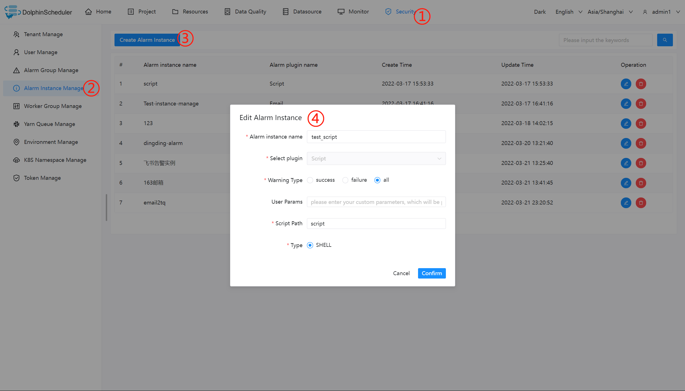

## Token Management

Since the back-end interface has a login check, token management provides a way to perform various operations on the system by calling the interface.

The administrator enters the `Security Center -> Token Management page`, clicks the `Create Token` button, selects the expiration time and user, clicks the `Generate Token` button, and clicks the `Submit` button, then create the selected user's token successfully.

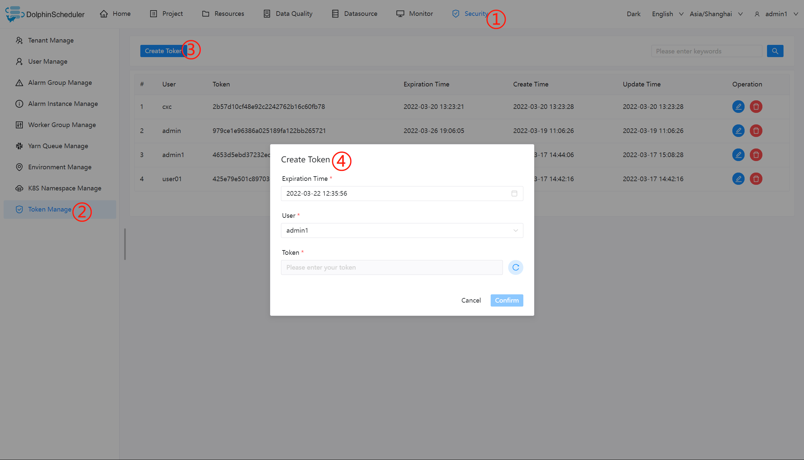

After a normal user logs in, click the user information in the username drop-down box, enter the token management page, select the expiration time, click the `Generate Token` button, and click the `Submit` button, then the user creates a token successfully.

Example of calling:

```java
/**
 * test token
 */
public  void doPOSTParam()throws Exception{
    // create HttpClient
    CloseableHttpClient httpclient = HttpClients.createDefault();
    // create http post request
    HttpPost httpPost = new HttpPost("http://127.0.0.1:12345/escheduler/projects/create");
    httpPost.setHeader("token", "123");
    // set parameters
    List<NameValuePair> parameters = new ArrayList<NameValuePair>();
    parameters.add(new BasicNameValuePair("projectName", "qzw"));
    parameters.add(new BasicNameValuePair("desc", "qzw"));
    UrlEncodedFormEntity formEntity = new UrlEncodedFormEntity(parameters);
    httpPost.setEntity(formEntity);
    CloseableHttpResponse response = null;
    try {
        // execute
        response = httpclient.execute(httpPost);
        // response status code 200
        if (response.getStatusLine().getStatusCode() == 200) {
            String content = EntityUtils.toString(response.getEntity(), "UTF-8");
            System.out.println(content);
        }
    } finally {
        if (response != null) {
            response.close();
        }
        httpclient.close();
    }
}
```

## Granted Permissions

The following rules apply to project authorization introduced in 3.5.0. Authorization has two dimensions: **what a user can do in a project**, and **which resources that project can use**. Operations that use resources require both the relevant project operation permission and the project resource grants.

### User permissions within a project

|     Permission     |                                               Allowed operations                                               |
|--------------------|----------------------------------------------------------------------------------------------------------------|
| `VIEW`             | View projects, workflow and task definitions, instances, logs, and selectable resources granted to the project |
| `DEVELOP`          | Create, edit and delete workflow and task definitions; import, copy or move definitions                        |
| `PUBLISH`          | Take workflow and task definitions online or offline                                                           |
| `EXECUTE`          | Manually start, backfill, rerun, recover, pause or stop workflow instances, and execute tasks within instances |
| `MANAGE_SCHEDULES` | Create, update, enable, disable or delete schedules                                                            |
| `MANAGE_MEMBERS`   | Assign or revoke these operation permissions for users within the current project                              |

Permissions are independent. For example, `DEVELOP` does not include `PUBLISH` or `EXECUTE`. Granting an operation permission does not automatically add `VIEW`; using the project through the UI generally also requires an explicit `VIEW` grant.

A project creator receives all six explicit permissions at project creation, and these can subsequently be revoked. Ordinary users cannot bypass project operation checks through creator status, legacy authorization records or resource ownership. **Project metadata updates and project deletion are separate lifecycle operations restricted to system administrators or the recorded project creator**, subject to business constraints such as whether the project can be deleted. Neither `DEVELOP` nor `MANAGE_MEMBERS` grants these operations. Revoking a creator's member permissions does not change the recorded creator, and editing project metadata does not transfer ownership.

System administrators pass project operation permission checks. However, when saving, taking definitions online or executing workflows, the project must still hold the required resource grants.

### Project resource-use grants

System administrators can grant projects access to eight resource types: datasources, worker groups, tenants, queues, environments, alert groups, Kubernetes namespaces and task groups. Grants belong to the project and are used by members within their operation permissions; individual resource grants for each member are not required.

Resource-use grants **do not grant permission to modify, delete or re-grant resources**. `MANAGE_MEMBERS` only manages member operation permissions within the current project. It cannot grant or revoke project resources or promote a user to system administrator. Only system administrators can grant or revoke project resources or query global resource catalogs without project context.

Project resource selectors require `projectCode` and filter results by the user's `VIEW` permission and the project's resource grants. Datasource selections omit connection parameters; environment selections omit environment configuration. Resource files are outside these eight types and retain their existing authorization mechanism.

Default resources also require explicit grants, including the `default` worker group and built-in `default` tenant when used. The built-in tenant already has a database record; do not create another one. If the tenant has a queue configured, the project also needs a grant for that queue. Grants for optional resources such as environments and alert groups are required when a concrete resource is selected.

### Checks for each operation

|                                                 Operation                                                 |                              User project permission                              |                                       Project resource checks                                       |
|-----------------------------------------------------------------------------------------------------------|-----------------------------------------------------------------------------------|-----------------------------------------------------------------------------------------------------|
| Create, update or import workflow/task definitions                                                        | `DEVELOP`                                                                         | Check resources referenced by the tasks being saved                                                 |
| Copy or move workflows to another project                                                                 | Source `VIEW` for copy; source `DEVELOP` for move; destination `DEVELOP` for both | Check task resources against the destination project; source grants do not move with the definition |
| Take a workflow or task definition online                                                                 | `PUBLISH`                                                                         | Check resources referenced by tasks in that version                                                 |
| Manually start, backfill, rerun, recover failed or suspended instances, or execute tasks within instances | `EXECUTE`                                                                         | Check resources in the executed version and resources used by the effective execution settings      |
| Create, update or enable schedules                                                                        | `MANAGE_SCHEDULES`                                                                | Check task resources and resources used by the schedule's execution settings                        |
| Take a workflow or task definition offline                                                                | `PUBLISH`                                                                         | Does not require restoring revoked resource grants                                                  |
| Disable or delete schedules                                                                               | `MANAGE_SCHEDULES`                                                                | Does not require restoring revoked resource grants                                                  |
| Pause or stop existing instances                                                                          | `EXECUTE`                                                                         | Does not require restoring revoked resource grants                                                  |

Execution settings include the worker group, tenant and its queue, and selected environment and alert group. Rerunning or recovering an existing instance checks its recorded workflow version and execution settings, rather than only the latest definition.

**The executing user does not need `DEVELOP` or personal grants for the workflow's resources of the eight types above, including datasources. Their project `EXECUTE` permission cannot replace the project's resource grants.** For example, an administrator grants datasource R to project P. Developer A, with P's `VIEW` and `DEVELOP`, can save a workflow using R. Operator B, with P's `VIEW` and `EXECUTE`, can manually execute it without a personal grant for R. This does not allow B to edit the workflow or modify R.

### Cross-project operations and subworkflows

Definition and instance checks use their actual owning project; resource-use checks use the grants of the project performing the operation. Permission on another project in the request path cannot replace these checks. Batch workflow-task queries only return workflows in projects where an ordinary user has `VIEW`. Legacy association records do not restore visibility. Cross-project parent/child instance and lineage queries also require `VIEW` on the corresponding projects.

Saving or taking a definition online when it references a subworkflow additionally requires `EXECUTE` on that subworkflow's project. Execution and schedule configuration or enabling check subworkflows recursively: the user needs `EXECUTE` on every child project, and each child's task resources are checked against that child's own project grants. Inherited tenant, queue, worker group, environment and alert-group settings are also checked against each child project. Parent project grants cannot replace child project grants.

### When revocation takes effect

- After a user's project operation permission is revoked, subsequent requests requiring it are rejected. Permissions are revoked independently: revoking only `VIEW` does not revoke other operation permissions. Revoking `VIEW` removes access through project lists, batch task queries and other project views. The creator's separate lifecycle permissions are described above.
- After a project resource grant is revoked, subsequent saves, taking definitions online, manual starts, backfills, reruns and recoveries, as well as schedule creation, updates and enabling, check the current grants. In the example above, after P loses access to R, B cannot manually start a workflow using R even if B still has `EXECUTE`.
- **Revocation does not retroactively stop running or queued instances, disable existing schedules, or recheck these project authorizations on subsequent background triggers of existing schedules or automatic retries.** Revoking permission alone therefore does not ensure existing workloads stop. Disable schedules separately to stop future scheduled triggers, and request instance stops separately to stop existing instances; these actions still require their corresponding permissions.

Project authorization controls DolphinScheduler operations and resource selection. Tasks still run on Workers using the configured tenants and resource credentials. Access to files, networks and database objects also depends on the operating system, deployment environment and datasource credentials. Project authorization does not sandbox task code or provide database table-level authorization.

### Configuration and upgrades

In Project Management, system administrators or users with `MANAGE_MEMBERS` use the member-permissions action to select and save permissions for a member. Saving replaces that member's permission set in the current project; an empty set revokes all member permissions. System administrators use resource authorization to select a resource type and resource, then grant or revoke project access. Member managers can assign all six project permissions to themselves or other users, including `MANAGE_MEMBERS`, so choose trusted member managers with that scope in mind.

Upgrades retain legacy authorization tables and data without automatic migration or fallback. Administrators must reassign project member permissions and project resource grants, including default resources that are used. See the [incompatible changes](../upgrade/incompatible.md#350).

The following screenshots show personal authorization before 3.5.0, for upgrade comparison only. Their read/write permissions and personal datasource grants do not replace the project member permissions and project resource grants described above.

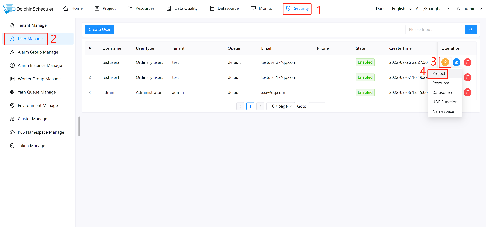

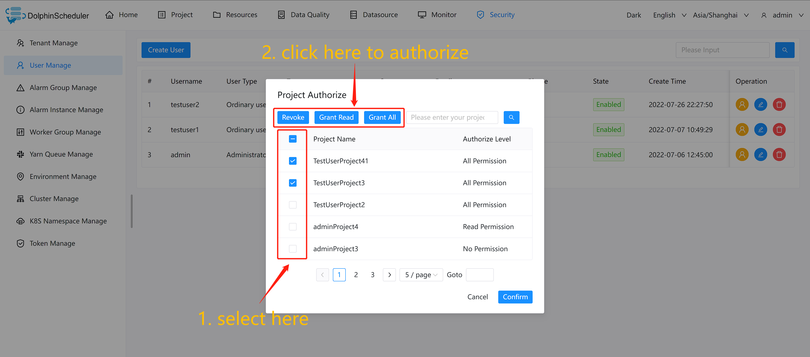

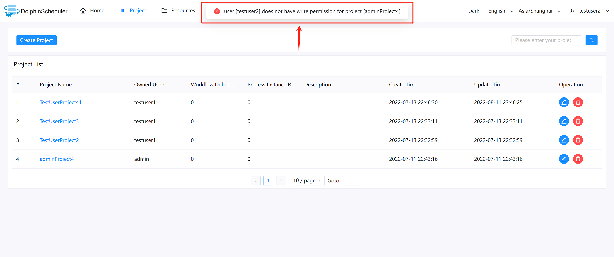

## Worker Grouping

Each worker node belongs to some worker groups, and the default group is `default`.

When DolphinScheduler executes a task, it will assign the task to the configured worker group and the worker nodes in the group will execute the task.

### Add or Update Worker Groups

- Open the `worker-server/conf/application.yaml` on the worker node where you want to configure the groups and modify the `groups` parameter in `worker` section.
- The values of the `groups` parameter are the names of the groups where the worker node belong. The default value is `default`.
- If the worker node belongs to multiple groups, list them with hyphens, e.g.

```conf
worker:
......
  groups:
    - default
    - group-1
    - group-2
......
```

- You can add new worker groups for the workers during runtime regardless of the configurations in `application.yaml` as below:
  `Security Center` -> `Worker Group Manage` -> `Create Worker Group` -> fill in `Group Name` and `Worker Addresses` -> click `confirm`.

## Environmental Management

- Configure the worker running environment online, a worker can specify multiple environments, each environment is equivalent to the `dolphinscheduler_env.sh` file.
- The default environment is the `dolphinscheduler_env.sh` file.
- When the task is executed, the task can be assigned to the specified worker group, and the corresponding environment can be selected according to the worker group, and finally the worker node in the group executes the environment and then executes the task.

### Add or update environment

The environment configuration is equivalent to the configuration in the `dolphinscheduler_env.sh` file.

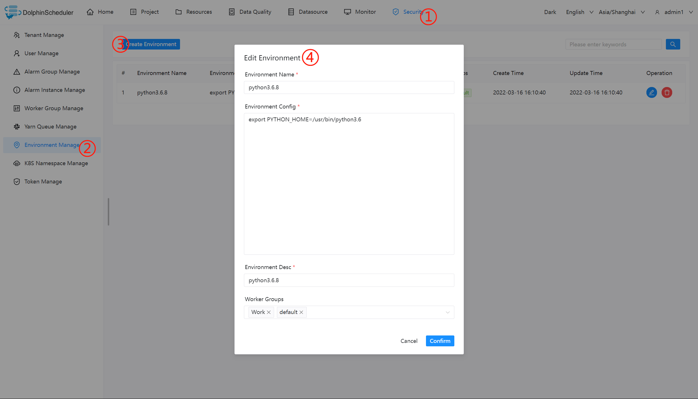

### Usage environment

Create a task node in the workflow definition, select the worker group and the environment corresponding to the worker group. When executing the task, the Worker will execute the environment first before executing the task.

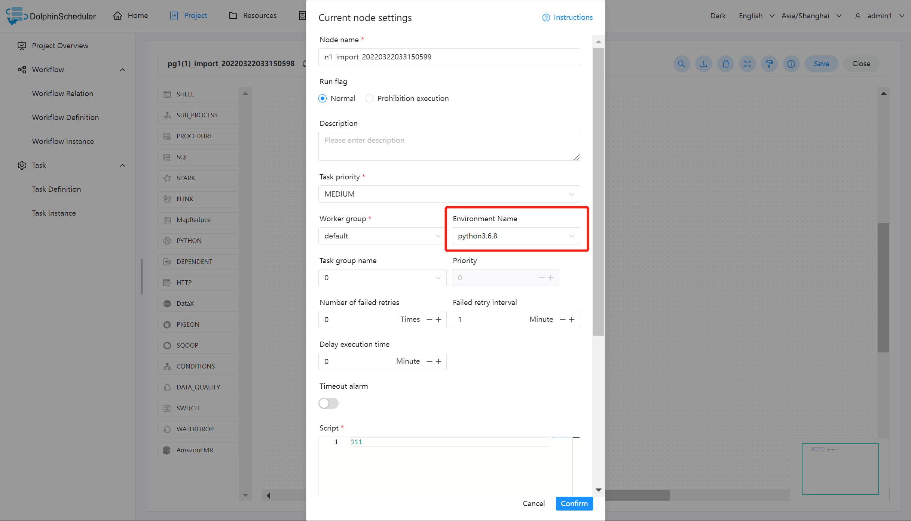

> NOTE: If you cannot select an environment in a workflow definition or when triggering workflows, check that it is associated with the selected worker group and that the project has resource-use grants for both the environment and the worker group.

## Cluster Management

> Add or update cluster
> - Each process can be related to zero or several clusters to support multiple environment, now just support k8s.
>
> Usage cluster
> - After creation and authorization, k8s namespaces and processes will associate clusters. Each cluster will have separate workflows and task instances running independently.

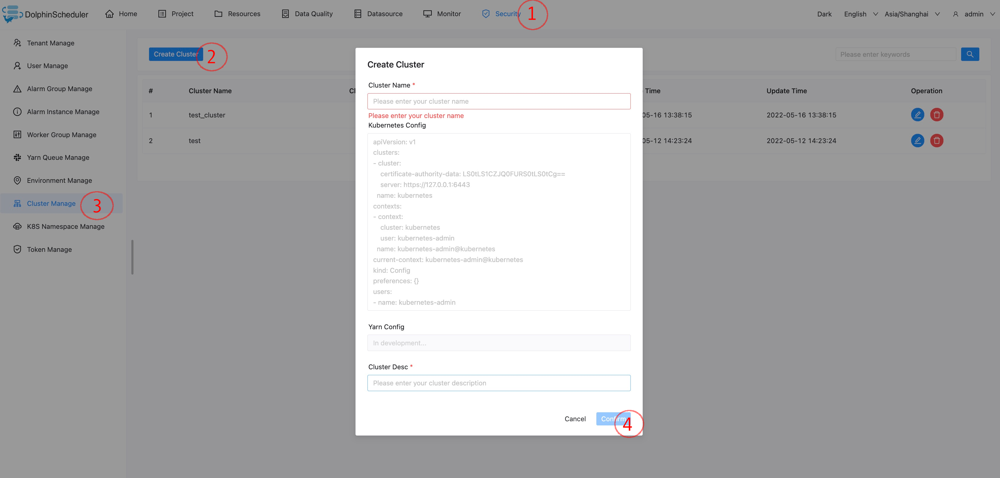

## Namespace Management

> Add or update k8s cluster

- First enter the configuration of the k8s cluster connection into the table `t_ds_k8s` in the database for batch job and will removed later, the creation of the namespace now selects the cluster by drop-down options.

> Add or update namespace

- After creation and authorization, you can select it from the namespace drop down list when edit k8s task, If the k8s cluster name is `ds_null_k8s` means test mode which will not operate the cluster actually.

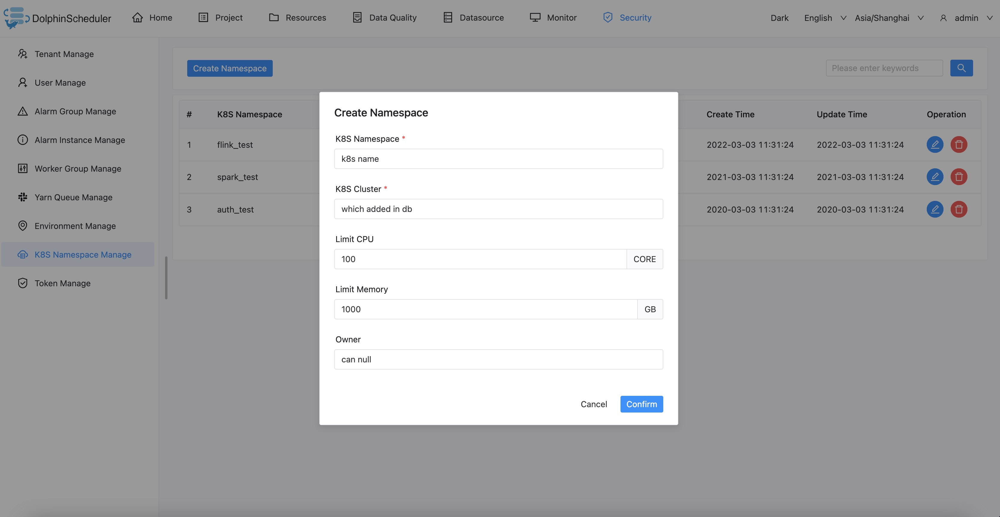

