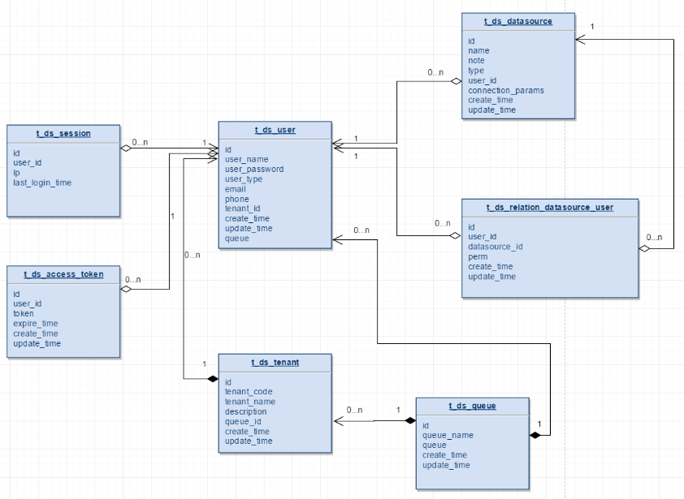
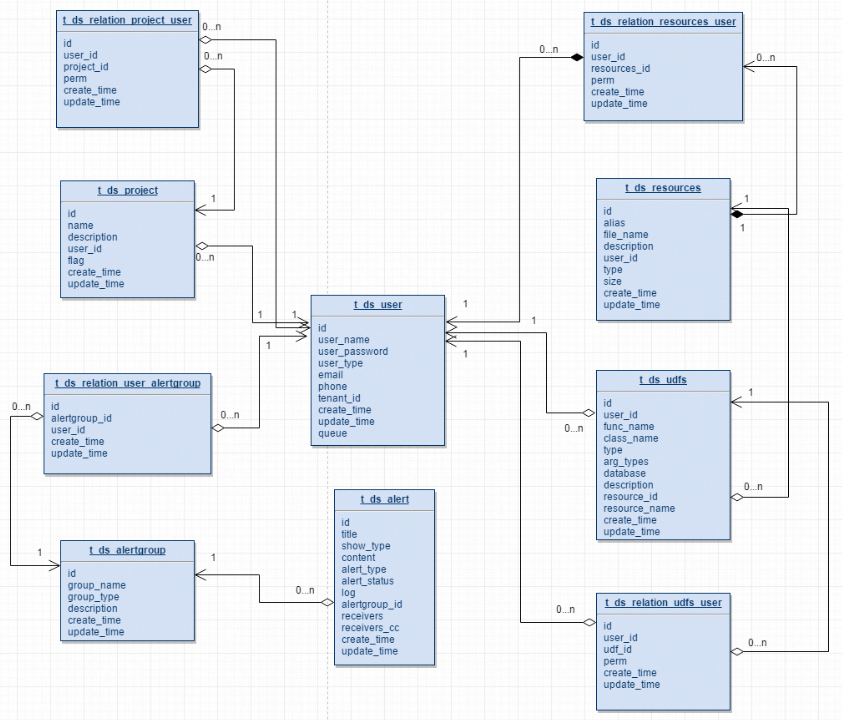
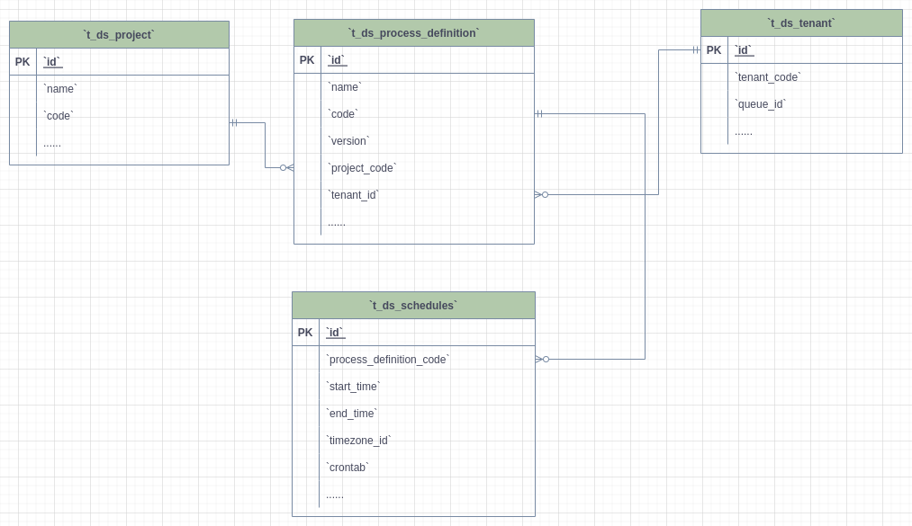
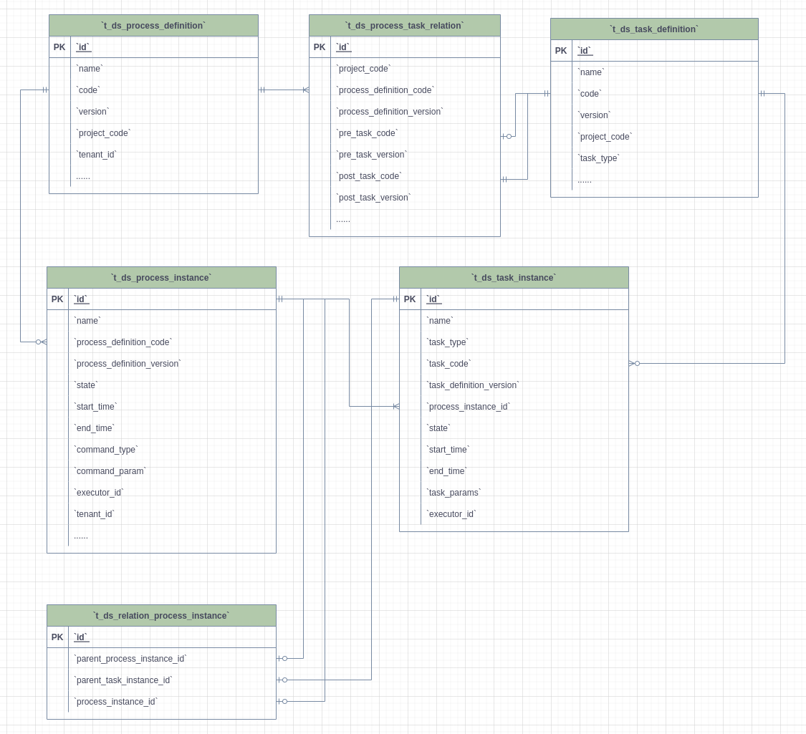

# DolphinScheduler 元数据文档

## 表Schema

详见 `dolphinscheduler-dao/src/main/resources/sql` 目录下的 SQL 文件，表结构以其为准。工作流和任务的存储方式详见[任务结构](task-structure.md)。

> 下方 E-R 图绘制于 `process` 相关表更名为 `workflow` 之前，图中部分表名已过时，以文字描述中的当前表名为准。

## E-R图

### 用户	队列	数据源

- 一个租户下可以有多个用户，用户未绑定租户时 `t_ds_user.tenant_id` 为 `-1`； 
- `t_ds_user`中的queue字段存储的是队列表中的`queue_name`信息，`t_ds_tenant`下存的是`queue_id`，用户队列为空时，用户页面显示租户的队列；任务实际使用的 YARN 队列由任务自身参数（如 SPARK、MR、FLINK 的 `yarnQueue`）决定； 
- `t_ds_datasource`表中的`user_id`字段表示创建该数据源的用户，`t_ds_relation_datasource_user`中的`user_id`表示对数据源有权限的用户； 

### 项目	资源	告警

- 一个用户可以有多个项目，用户项目授权通过`t_ds_relation_project_user`表完成project_id和user_id的关系绑定； 
- `t_ds_project`表中的`user_id`表示创建该项目的用户，`t_ds_relation_project_user`表中的`user_id`表示对项目有权限的用户； 
- 资源由存储插件管理，图中的 `t_ds_resources` 仅被资源迁移工具读取； 
- 告警组存储在 `t_ds_alertgroup` 中，由 `t_ds_schedules`、`t_ds_workflow_definition` 和 `t_ds_workflow_instance` 的 `warning_group_id` 引用； 

### 项目 - 租户 - 工作流定义 - 定时

- 一个项目可以有多个工作流定义，每个工作流定义只属于一个项目； 
- 一个租户可以被多个工作流使用。租户不属于工作流定义，而是在启动或定时调度工作流时选择，保存在 `t_ds_schedules.tenant_code`、`t_ds_command.tenant_code` 和 `t_ds_workflow_instance.tenant_code` 中，默认值为 `default`； 
- 一个工作流定义可以有零个或一个定时配置； 

### 工作流定义和执行

- 一个工作流定义对应多个任务定义，通过`t_ds_workflow_task_relation`进行关联，关联的key是`code + version`，当任务没有上游任务时，对应的`pre_task_code`和`pre_task_version`为0；
- 一个工作流定义可以有多个工作流实例`t_ds_workflow_instance`，一个工作流实例对应零个或多个任务实例`t_ds_task_instance`；
- `t_ds_relation_workflow_instance`表存放的数据用于处理工作流定义中含有子工作流的情况，`parent_workflow_instance_id`表示含有子工作流的父工作流实例id，`workflow_instance_id`表示子工作流实例的id，`parent_task_instance_id`表示子工作流节点的任务实例id，工作流实例表和任务实例表分别对应`t_ds_workflow_instance`表和`t_ds_task_instance`表；

