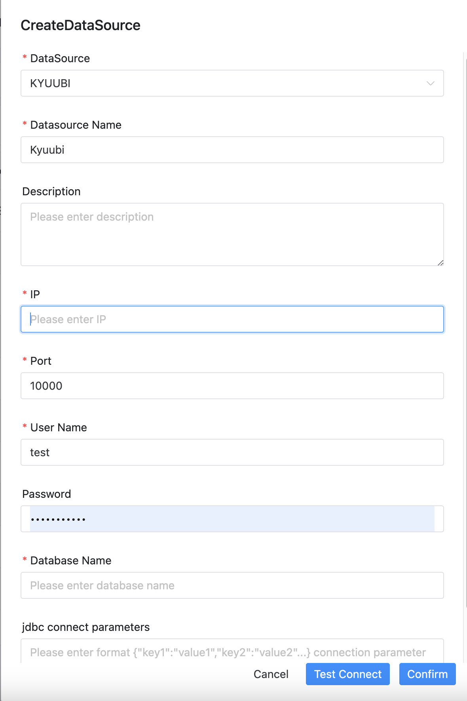

# KYUUBI数据源

## 使用HiveServer2



- 数据源：选择 KYUUBI
- 数据源名称：输入数据源的名称
- 描述：输入数据源的描述
- IP 主机名：输入连接 KYUUBI 的 IP
- 端口：输入连接 KYUUBI 的端口
- 用户名：设置连接 KYUUBI 的用户名
- 密码：设置连接 KYUUBI 的密码
- 数据库名：输入连接 KYUUBI 的数据库名称
- Jdbc 连接参数：用于 KYUUBI 连接的参数设置，以 JSON 形式填写

```Kerberos 验证
如需Kerberos验证，请直接配置相应参数在jdbc连接参数中

clientKeytab: 用户客户端验证的keytab文件路径

clientPrincipal: 用户客户端验证的Kerberos principal

serverPrincipal: 在服务端通过kyuubi.kinit.principal配置的Kerberos principal.
```

## 自定义 JDBC URL

在 Kyuubi 的“连接配置方式”中选择 **JDBC URL**，可直接填写完整连接字符串，替代主机、端口、数据库和 JDBC 参数输入。已有数据源默认使用“常规配置”，升级后无需迁移。

```text
jdbc:kyuubi://kyuubi-server:10009/default;socketTimeout=600000?kyuubi.engine.share.level=USER;kyuubi.engine.share.level.subdomain=example
```

`;` 后为客户端参数，`?` 或 `#` 引入会话参数，由 Kyuubi 驱动解析。catalog、服务发现、HTTP 和认证参数的支持范围取决于实际驱动与服务端版本；本功能不升级这些组件。

用户名、密码继续在原字段填写，不要在 URL 中配置 `user` 或 `password`。URL 模式下，旧主机、端口、数据库和 JDBC 参数输入不参与连接。建议测试连接后保存。切回常规配置时，需填写有效的原连接字段。

创建、更新和连接测试 API 新增可选字符串 `rawJdbcUrl`，保存在原连接参数 JSON 中，运行时 `jdbcUrl` 由其派生。非空值优先于旧连接字段，`other` 不再拼接或额外注入驱动。未提供或空白时保持旧行为，无需修改数据库表结构。

使用完整 URL 前，需为 API 和 Worker 部署更新后的插件。`HIVE` 类型数据源保持原样，即使它实际连接 Kyuubi Server。

## 是否原生支持

- 否，使用前需请参考 [pseudo-cluster](../installation/pseudo-cluster.md) 中的 "下载插件依赖" 章节激活数据源。

