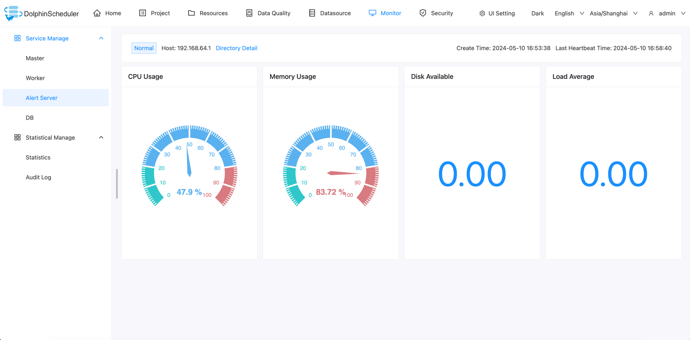
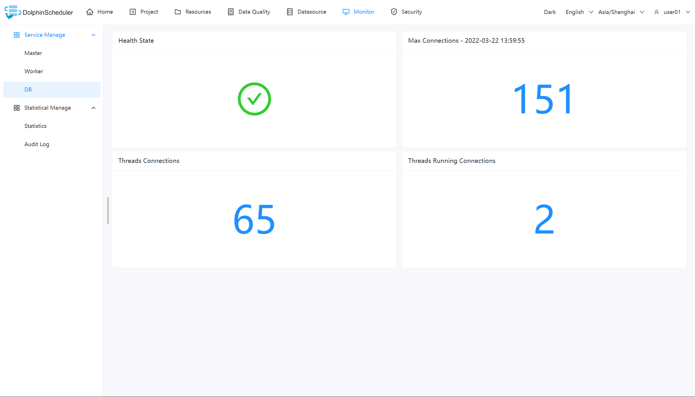
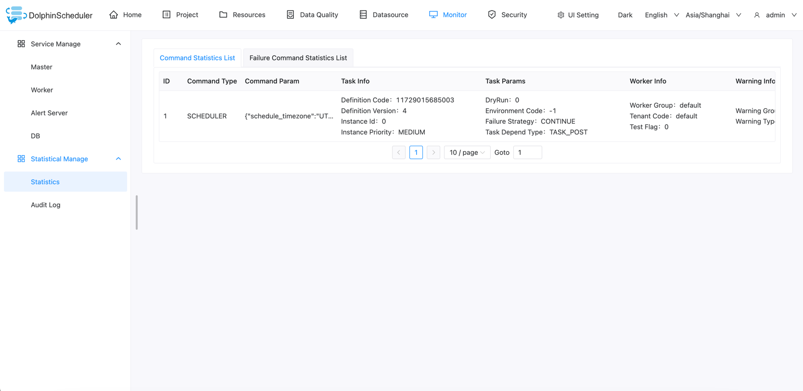
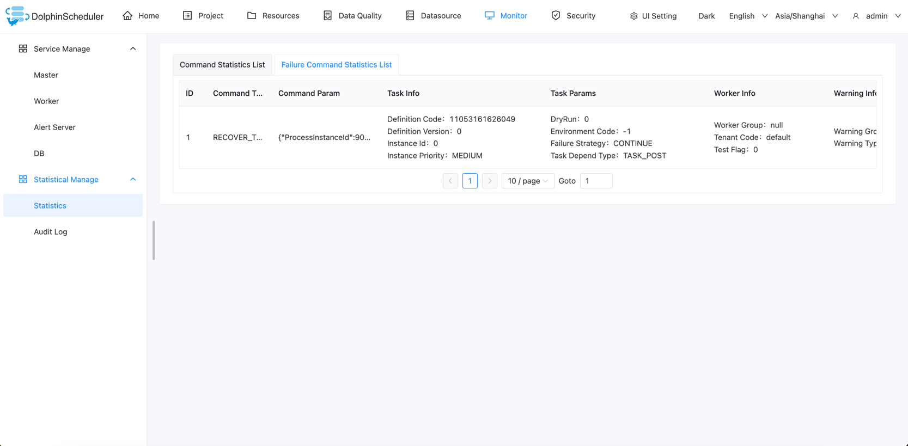
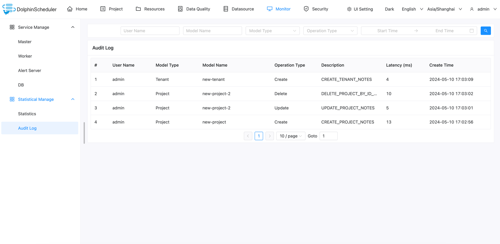

# 监控中心

## 服务管理

- 服务管理主要是对系统中的各个服务的健康状况和基本信息的监控和显示

### 集群总览

集群总览替代原 Master、Worker 独立页面，通过监控接口发现已注册的 API、Master、Worker 和 Alert Server 实例，并查询当前元数据。拓扑从上到下依次展示 API、Master 和 Worker，Worker 按分组聚合，点击分组可展开具体节点。连线表示逻辑架构关系，不代表实时网络通信。

节点列表展示 CPU、内存利用率。元数据查询失败时，节点仍保留在注册列表中，指标显示为未知，不会直接标记为离线。Alert Server 的 Active/Standby 角色与节点健康状态分开展示。点击刷新会重新查询节点及元数据；部分角色的请求失败时会明确提示，并保留该角色上次获取的节点，将其指标标为未知。

管理员可从节点详情或列表操作查看 Master 上运行中的工作流和任务，以及 Worker 上运行中的任务。工作流实例链接可跳转至对应项目的实例详情。运行实例查询失败时展示错误和重试入口，不会显示成空列表。

API 实例在 `/nodes/api` 下注册稳定身份，通过 `api.rpc-port`（默认 `12346`）提供元数据 RPC。部署时需允许 API 实例之间通过内部网络访问该端口；监听器沿用现有 `rpc.authentication.*` 配置。API 的 HTTP 端口单独返回，不受此配置影响。API 实例升级后才会注册并出现在拓扑中，页面不会推测未注册的实例。

原 Master、Worker、DB 页面地址会跳转至集群总览。独立 DB 菜单入口已移除，Alert Server 页面仍保留。

### Alert Server

- 主要是 alert server 的相关信息。

## Database

- 主要是 DB 的健康状况

## 统计管理

### Statistics

展示系统中的命令列表，数据来自`t_ds_command`表。

展示系统中的失败命令列表，数据来自`t_ds_error_command`表。

### 审计日志

审计日志的记录提供了有关谁访问了系统，以及他或她在给定时间段内执行了哪些操作的信息，对于维护安全都很有用。

