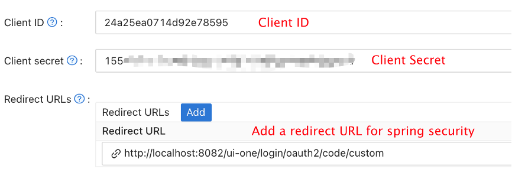
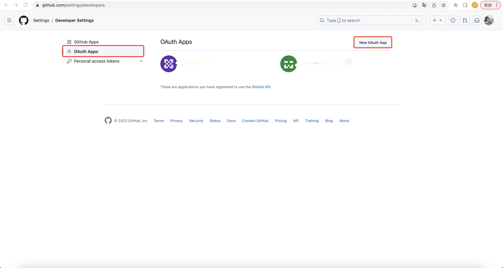
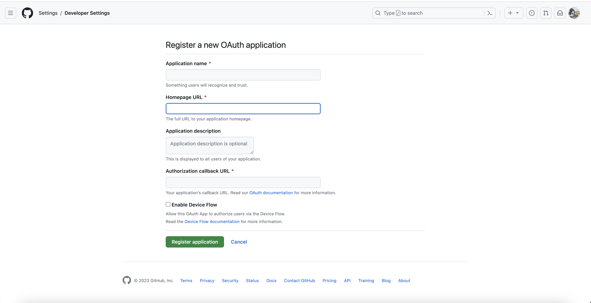
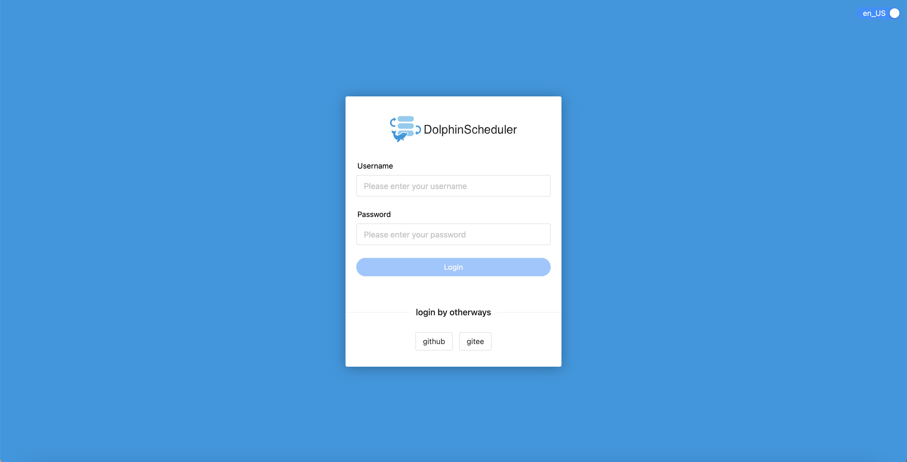

# 认证方式

* 目前我们支持四种认证方式，Apache DolphinScheduler自身账号密码登录，LDAP, 通过Casdoor实现的SSO登录和通过Oauth2授权登录，并且oauth2授权登录方式可以和其他认证方式同时使用。

## 修改认证方式

> dolphinscheduler-api/src/main/resources/application.yaml

```yaml
security:
  authentication:
    # Authentication types (supported types: PASSWORD,LDAP,CASDOOR_SSO)
    type: PASSWORD
    # IF you set type `LDAP`, below config will be effective
    ldap:
      # ldap server config
      url: ldap://ldap.forumsys.com:389/
      base-dn: dc=example,dc=com
      username: cn=admin,dc=example,dc=com
      password: password
      user:
         # admin userId when you use LDAP login
         admin: ldap-admin
         # user search filter to find admin user
         identity-attribute: uid
         email-attribute: mail
         # action when ldap user is not exist (supported types: CREATE,DENY)
         not-exist-action: DENY
      ssl:
         enable: false
         # jks file absolute path && password
         trust-store: "/ldapkeystore.jks"
         trust-store-password: "password"
    casdoor:
      user:
        admin: ""
    oauth2:
      enable: false
      provider:
        github:
          authorizationUri: ""
          redirectUri: ""
          clientId: ""
          clientSecret: ""
          tokenUri: ""
          userInfoUri: ""
          callbackUrl: ""
          iconUri: ""
          provider: github
        google:
          authorizationUri: ""
          redirectUri: ""
          clientId: ""
          clientSecret: ""
          tokenUri: ""
          userInfoUri: ""
          callbackUrl: ""
          iconUri: ""
          provider: google
casdoor:
   # Your Casdoor server url
   endpoint: ""
   client-id: ""
   client-secret: ""
   # The certificate may be multi-line, you can use `|-` for ease
   certificate: ""
   # Your organization name added in Casdoor
   organization-name: ""
   # Your application name added in Casdoor
   application-name: ""
   # Doplhinscheduler login url
   redirect-url: ""
```

## 通过 Casdoor 实现 SSO 登录

Casdoor 是基于 OAuth 2.0、OIDC、SAML 和 CAS 的面向 UI 的身份访问管理（IAM）/单点登录（SSO）平台。您可以通过以下步骤通过 Casdoor 为 Dolphinscheduler 添加 SSO 功能：

### 步骤1. 部署 Casdoor

首先，需要部署 Casdoor。 您可以参考 Casdoor 官方文档进行[安装](https://casdoor.org/docs/basic/server-installation)。 成功部署后，您需要确保：

* Casdoor 服务器在 http://localhost:8000 上成功运行。
* 打开您喜欢的浏览器并访问 http://localhost:7001 ，您将看到 Casdoor 的登录页面。
* 输入 admin 和 123，测试登录功能是否正常工作。

然后，您可以通过以下步骤在自己的应用程序中快速实现基于 Casdoor 的登录页面。

### 步骤2. 配置 Casdoor

1. 创建或使用现有的 Casdoor 应用程序。
2. 添加您的重定向 URL（您可以在下一节中了解更多关于如何获取重定向 URL 的详细信息）
   
3. 添加您想要的提供程序并补充其他设置。

不出所料，您可以在应用程序设置页面上获得两个值：`Client ID` 和 `Client secret`，如上图所示。我们将在下一步中使用它们。

打开您喜欢的浏览器并访问：**http://`CASDOOR_HOSTNAME`/.well-known/openid-configuration**，您将看到 Casdoor 的 OIDC 配置。

### 步骤3. 配置 Dolphinscheduler

> dolphinscheduler-api/src/main/resources/application.yaml

```yaml
security:
  authentication:
    # Authentication types (supported types: PASSWORD,LDAP,CASDOOR_SSO)
    type: CASDOOR_SSO
casdoor:
  # Your Casdoor server url
  endpoint:
  client-id:
  client-secret:
  # The certificate may be multi-line, you can use `|-` for ease
  certificate: 
  # Your organization name added in Casdoor
  organization-name:
  # Your application name added in Casdoor
  application-name:
  # Doplhinscheduler login url
  redirect-url: http://localhost:5173/login 
```

## 通过OAuth2授权认证登录

dolphinscheduler可以同时支持多种OAuth2的provider，只需要在配置文件中打开Oauth2的开关并进行简单的配置即可。

### 步骤1. 获取OAuth2客户端凭据





### 步骤2. 在api的配置文件中开启oauth2登录

```yaml
security:
  authentication:
    …… # 省略
    oauth2:
      # 将enable设置为true 开启oauth2登录模式
      enable: true
      provider:
        github:
          # 设置provider的授权地址，例如https://github.com/login/oauth/authorize
          authorizationUri: ""
          # dolphinscheduler的后端重定向接口地址，例如http://127.0.0.1:12345/dolphinscheduler/redirect/login/oauth2
          redirectUri: ""
          # oauth2的 clientId
          clientId: ""
          # oauth2的 clientSecret
          clientSecret: ""
          # 设置provider的请求token的地址
          tokenUri: ""
          # 设置provider的请求用户信息的地址
          userInfoUri: ""
          # 登录成功后的重定向地址, http://{ip}:{port}/login
          callbackUrl: ""
          # 登录页跳转按钮的图片url，不填写则会展示一个文字按钮
          iconUri: ""
          provider: github
        google:
          authorizationUri: ""
          redirectUri: ""
          clientId: ""
          clientSecret: ""
          tokenUri: ""
          userInfoUri: ""
          callbackUrl: ""
          iconUri: ""
          provider: google
        gitee:
          authorizationUri: "https://gitee.com/oauth/authorize"
          redirectUri: "http://127.0.0.1:12345/dolphinscheduler/redirect/login/oauth2"
          clientId: ""
          clientSecret: ""
          tokenUri: "https://gitee.com/oauth/token?grant_type=authorization_code"
          userInfoUri: "https://gitee.com/api/v5/user"
          callbackUrl: "http://127.0.0.1:5173/login"
          iconUri: ""
          provider: gitee
```

### 步骤3.使用oauth2登录



## 服务间 RPC 认证

API、Master、Worker、Alert 支持使用集群共享密钥认证内部 RPC 连接，默认关闭。在各服务（包括 standalone）使用的
`conf/common.properties` 中配置：

```properties
rpc.authentication.enabled=true
rpc.authentication.secret=<Base64 编码的 32 字节随机密钥>
```

使用 `openssl rand -base64 32` 生成随机密钥，将相同值配置到所有服务实例，不要使用人工设置的密码。
限制 `common.properties` 仅允许服务账户读取，并防止工作流代码读取密钥。可通过环境变量
`RPC_AUTHENTICATION_ENABLED`、`RPC_AUTHENTICATION_SECRET`
覆盖 properties 配置，也可通过 Kubernetes Secret 注入密钥。解码后的密钥不会在网络上传输，认证配置错误也不会包含密钥值。
与其他 common 配置一致，配置 DEBUG 日志可能包含密钥，仅应允许可信运维人员访问这些日志。

连接在 RPC 报文解码之前执行带版本号的定长挑战应答握手。服务端和客户端各生成独立的 32 字节随机数，
使用 HMAC-SHA256 对协议上下文、区分客户端与服务端的角色字节以及双方随机数计算证明，并使用常量时间比较验证。
认证结果仅属于当前连接，重连后必须重新认证。业务请求和心跳均不能绕过认证；认证无效、缺失或超时会关闭连接，
不会降级为无认证 RPC。启用认证的客户端也会拒绝连接到不支持认证的服务端。
启用认证但密钥缺失或内容无效时，RPC 客户端或服务端配置构造失败，不会创建无认证连接。
Master、Worker、Alert 在启动创建 RPC 服务时校验；API 若尚未使用 RPC，则在首次使用客户端时校验。
内部固定使用 5 秒握手期限，及时关闭一直不完成认证的连接，无需额外配置，与业务 RPC 请求超时独立。

该机制验证集群成员身份，所有持有密钥的服务具有相同 RPC 身份，不提供服务角色或用户级权限控制。
它不加密或保护后续 RPC 流量的完整性，也不能阻止主动网络攻击者转发握手并篡改后续通信。
仍须隔离 RPC 网络，并防止工作流代码读取密钥。该握手协议与 Spark 的认证协议不兼容。

升级时，先在关闭认证的情况下升级全部服务，再协调所有服务开启认证并重启。
认证开启与关闭的服务不能互通。配置通过 `PropertyUtils` 读取，优先级为环境变量、JVM 参数、`common.properties`。
客户端在首次使用时自动初始化，不需要额外的 Spring 认证配置 Bean，也无需显式调用初始化方法。
凭据在进程内缓存，修改配置文件不会更新运行中的客户端或服务端凭据。
轮换密钥需要协调所有服务使用新密钥重启，本期不提供双密钥过渡或热更新。

本功能暂未包含 TLS/mTLS，后续可在认证处理器之前增加 TLS/mTLS，不需要修改业务 RPC 接口。
