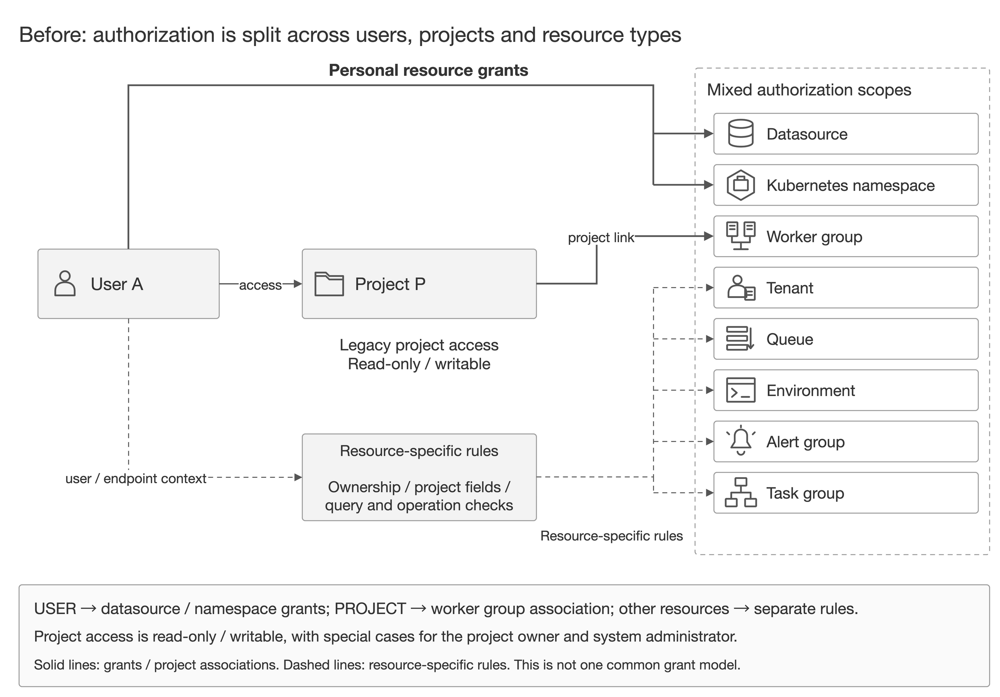
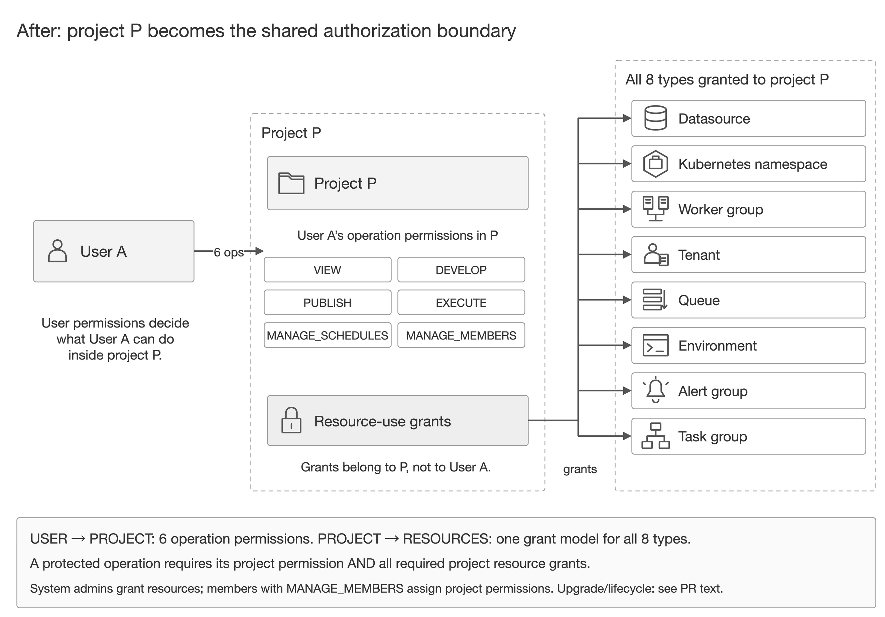

# 不向前兼容的更新

本文档记录了各版本之间不兼容的更新内容。在升级到相关版本前，请检查本文档。

## 3.0.0

* 复制和导入工作流不再添加 'copy' 后缀 [#10607](https://github.com/apache/dolphinscheduler/pull/10607)
* 使用分号作为默认的 SQL 语句分隔符 [#10869](https://github.com/apache/dolphinscheduler/pull/10869)

## 3.2.0

* 将 `common.properties` 中 `data-quality.jar.name` 属性重命名为 `data-quality.jar.dir` 并表示目录 ([#15563](https://github.com/apache/dolphinscheduler/pull/15563))
* 移除 `common.properties` 中 `data-quality.jar.name` 属性的默认键值 ([#15551](https://github.com/apache/dolphinscheduler/pull/15551))
* 移除 `StorageOperate` 的 `download()` 中的 `deleteSource` 参数 ([#14084](https://github.com/apache/dolphinscheduler/pull/14084))
* 将默认的 Unix Shell 执行器从 sh 改为 bash ([#12180](https://github.com/apache/dolphinscheduler/pull/12180))
* 从 Spark 任务中移除 Spark 版本参数 ([#11860](https://github.com/apache/dolphinscheduler/pull/11860))
* 更新了SQL任务中用于匹配变量的正则表达式 ([#13378](https://github.com/apache/dolphinscheduler/pull/13378))
* 更改了环境变量名称，将 `PYTHON_HOME` 改为 `PYTHON_LAUNCHER`， 将 `DATAX_HOME` 改为 `DATAX_LAUNCHER` ([#14523](https://github.com/apache/dolphinscheduler/pull/14523))
* 将mysql驱动版本从8.0.16升级至8.0.33 ([#14684](https://github.com/apache/dolphinscheduler/pull/14684))
* 在 /datasources/tables && /datasources/tableColumns 接口中添加了必选字段`database` [#14406](https://github.com/apache/dolphinscheduler/pull/14406)
* 资源中心相关接口删除请求参数 `description` ([#14394](https://github.com/apache/dolphinscheduler/pull/14394))

## 3.3.0

* 从 `资源中心` 中移除 `udf-manage` 功能 ([#16209](https://github.com/apache/dolphinscheduler/pull/16209))
* 从 `任务插件` 中移除 `Pigeon` 类型 ([#16218](https://github.com/apache/dolphinscheduler/pull/16218))
* 统一代码中的 `process` 为 `workflow` ([#16515](https://github.com/apache/dolphinscheduler/pull/16515))
* 废弃从 1.x 至 2.x 的升级代码  ([#16543](https://github.com/apache/dolphinscheduler/pull/16543))
* 移除 `数据质量` 模块  ([#16794](https://github.com/apache/dolphinscheduler/pull/16794))
* 在`application.yaml`中移除`registry-disconnect-strategy`配置 ([#16821](https://github.com/apache/dolphinscheduler/pull/16821))
* 在 `worker` 的 `application.yaml` 中移除 `exec-threads`，使用`physical-task-config`替代;在master的`application.yaml`中移除`master-async-task-executor-thread-pool-size`使用`logic-task-config`替代 ([#16790](https://github.com/apache/dolphinscheduler/pull/16790))
* 在 `t_ds_worker_group` 表中移除 无用的 `other_params_json` 字段 ([#16860](https://github.com/apache/dolphinscheduler/pull/16860))
* 从 `任务插件` 中移除 `Dynamic` 类型 ([#16482](https://github.com/apache/dolphinscheduler/pull/16842))

## 3.4.0

* 将数据源配置下SSH连接参数中的publicKey字段重命名为privateKey。 ([#17666](https://github.com/apache/dolphinscheduler/pull/17666))
* 添加数据表 t_ds_serial_command。 ([#17531](https://github.com/apache/dolphinscheduler/pull/17531))
* 移除 `api-server/application.yaml` 中 `python-gateway.auth-token` 的默认值。 ([#17801](https://github.com/apache/dolphinscheduler/pull/17801))
* 重构使用 ShellCommandExecutor 的任务插件 ([#17790](https://github.com/apache/dolphinscheduler/pull/17790))
* 从 `任务插件` 中移除 `Pytorch` 类型 ([#17808](https://github.com/apache/dolphinscheduler/pull/17808))，如果您仍在使用该任务类型，请在升级前删除 `t_ds_task_definition` 和 `t_ds_task_definition_log` 中 `task_type = 'PYTORCH'` 的数据。

## 3.4.1

* 移除导入导出工作流([#17940](https://github.com/apache/dolphinscheduler/issues/17940))

## 3.4.3

* 为 `t_ds_schedules` 表新增 `missed_fire_policy` 字段。现有定时默认使用 `FIRE_ALL_MISSED`，以保持原有 Quartz `IgnoreMisfires` 行为。([#18464](https://github.com/apache/dolphinscheduler/pull/18464))
* 移除已废弃的 Dynamic Task 查询接口。([#18556](https://github.com/apache/dolphinscheduler/issues/18556))
* 移除已废弃的任务及其上游关系更新接口 `PUT /projects/{projectCode}/task-definition/{code}/with-upstream`。([#18568](https://github.com/apache/dolphinscheduler/issues/18568))
* 移除已废弃的集群查询接口 `GET /cluster/query-by-code`。
* 工作流实例列表接口（`GET /projects/{projectCode}/workflow-instances`、`GET /projects/{projectCode}/workflow-instances/top-n`、`GET /projects/{projectCode}/workflow-instances/trigger`）的响应体不再返回以下属性：
  * **移除的大字段**：`commandParam`、`globalParams`、`historyCmd`、`varPool`、`stateHistory`
  * **移除的非数据库字段**：`stateDescList`、`workflowDefinition`、`dagData`、`queue`、`locations`、`dependenceScheduleTimes`
  * **移除的派生属性**：`cmdTypeIfComplement`、`complementData`（补数执行相关，如需获取请使用详情接口）
  * 如需获取这些字段，请使用详情接口 `GET /projects/{projectCode}/workflow-instances/{id}`，该接口仍返回完整的 `WorkflowInstance` 对象 ([#18444](https://github.com/apache/dolphinscheduler/pull/18444))

## 3.5.0

* 仅系统管理员或项目创建者可以修改项目信息、删除项目。修改项目信息保留原所有者，`DEVELOP` 不包含这些项目生命周期操作。
* 权限模型改为“用户拥有项目操作权限，项目获得资源使用授权”。升级程序新增 `t_ds_project_user_permission` 和 `t_ds_project_resource_authorization` 两张表，保留旧授权表及数据，但不自动迁移历史权限。管理员需要重新分配项目成员权限及项目资源授权，用户才能继续查询、配置、发布或人工执行项目任务。
* 项目内的资源查询需要传入 `projectCode`，按项目 `VIEW` 权限及资源授权过滤；不带项目参数的全局资源目录仅管理员可查询。移除数据源和命名空间的个人授权接口，改为向项目授权。
* 保存、发布和人工启动、重跑时检查项目资源授权。撤销资源授权不重新鉴权既有运行或排队实例、后台定时触发和自动重试，也不会自动下线已有定时。
* `AlertSender#getAlertData` 对 null `alertType` 增加了显式拒绝（抛 `IllegalArgumentException` 并记录错误日志），而非直接抛 `NullPointerException`。滚动升级时**必须先升级 Alert Server，再升级 Master/Worker**，否则旧 Alert Server 无法识别新增的 `alert_type` 枚举值（如 `TASK_RESULT`），会导致告警投递失败。详见[升级文档](upgrade.md#滚动升降级顺序)。([#18549](https://github.com/apache/dolphinscheduler/pull/18549))
* SQL 任务结果告警内容有大小限制：默认最多保留 30 行，超过 100 字符的字符串字段值会被截断并以省略号标记；序列化后内容总大小限制在 60000 UTF-8 字节以内（兼容 MySQL TEXT 列 65535 字节容量），超出预算的行以省略标记对象表示。以上默认值可通过 `common.properties` 中的 `sql.task.alert.max.rows`、`sql.task.alert.max.row.value.length`、`sql.task.alert.max.content.bytes` 配置调整，修改后需重启 Worker 生效。 ([#18549](https://github.com/apache/dolphinscheduler/pull/18549))

### 项目权限模型

完整的操作权限、项目资源授权、跨项目校验及撤权生效边界见[安全中心（权限系统）](../security/security.md#授予权限)。

以下架构图对比旧权限模型与 3.5.0 引入的项目权限模型。

